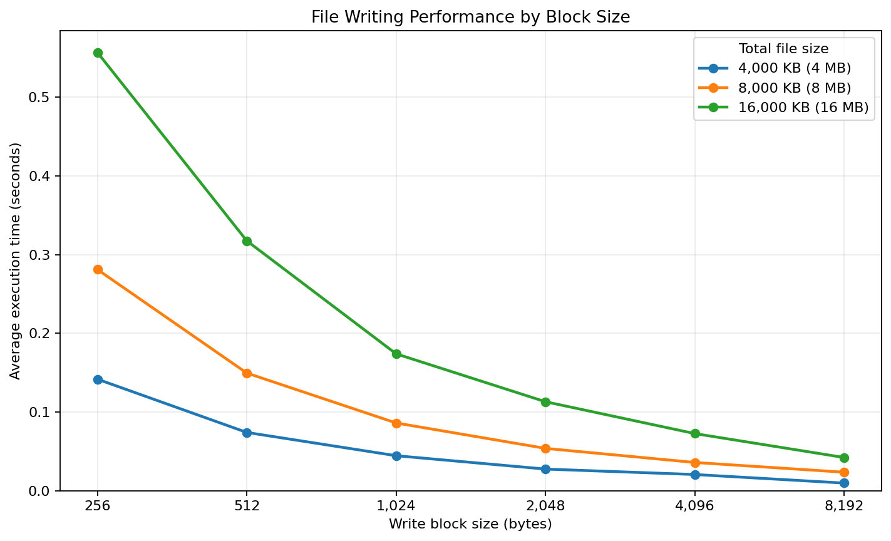
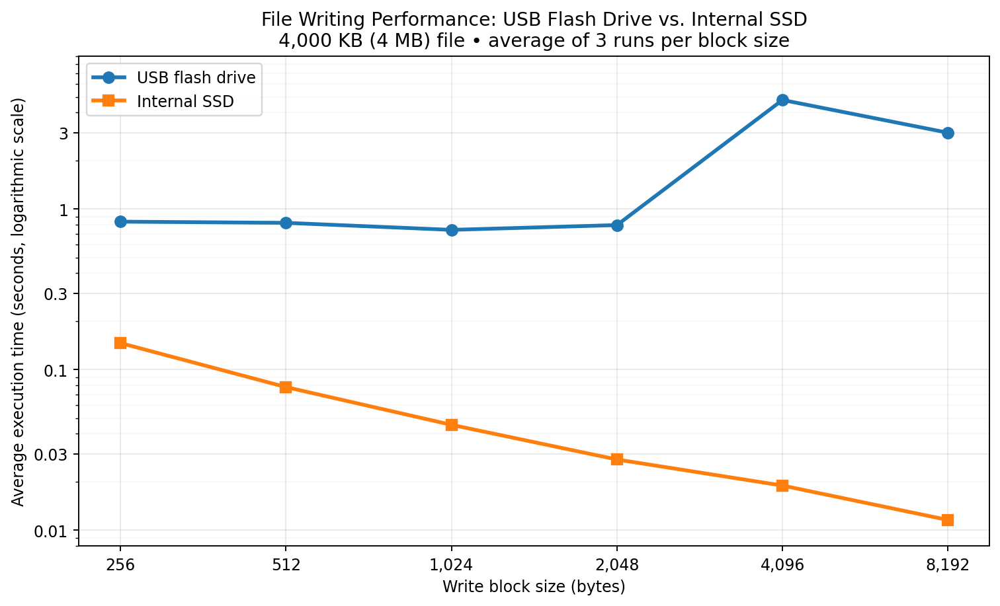

# H7 – Benchmarks and Performance

### 1. Geekbench CPU and GPU Benchmarks

Download and run the current version of [Geekbench](https://www.geekbench.com/) on your personal computer or another computer to which you have access.

**a.** Run the CPU benchmark and record your processor's **single-core** and **multi-core** scores.

**b.** Run the GPU benchmark and record your **GPU score** and the compute API used (e.g., OpenCL, Vulkan, or Metal). If your computer does not support the GPU benchmark, explain why.

**c.** Save both benchmark reports as PDF files using your browser's Print to PDF feature.

**d.** Review your CPU benchmark results. How do your single-core and multi-core scores compare? Explain why they differ, considering the number of processor cores and the workloads being measured. **(1–2 paragraphs)**

---

### 2. (A, B, C) File Writing Performance Benchmark

Run the sample Python program **performance_2026.py** on your personal computer. The program measures how different write block sizes affect file-writing performance.

**a.** Review the program, which writes data using block sizes of 256, 512, 1024, 2048, 4096, and 8192 bytes. Each test runs three times and reports the average execution time and transfer rate (MB/s).

**b.** Select three different file sizes (in KB) that produce meaningful performance results. Choose sizes that allow the tests to complete in a reasonable amount of time. Run the benchmark for each file size using your computer's internal storage.

**c.** Create a table and graph showing your results for the three file sizes. The graph should compare write block size (horizontal axis) with average execution time (vertical axis), using a separate series for each file size.

Write a paragraph interpreting your results. How does block size affect performance? Did larger blocks always produce faster results? Were the results what you expected? **(1 paragraph)**

#### Sample Table – Part C: File Writing Performance

*Average execution time (seconds) by block size and total file size*

| Block Size (bytes) | 4,000 KB (4 MB) | 8,000 KB (8 MB) | 16,000 KB (16 MB) |
| ------------------ | --------------- | --------------- | ----------------- |
| 256                | 0.1417          | 0.2811          | 0.5571            |
| 512                | 0.0740          | 0.1495          | 0.3176            |
| 1,024              | 0.0444          | 0.0860          | 0.1739            |
| 2,048              | 0.0274          | 0.0537          | 0.1130            |
| 4,096              | 0.0205          | 0.0358          | 0.0725            |
| 8,192              | 0.0096          | 0.0234          | 0.0421            |

*Sample results from an internal SSD. Each value represents the average of three benchmark runs. Lower times indicate better performance.*

#### Sample Graph – Part C: File Writing Performance

---

### 2. (D) USB Comparison Transfer Rates

**d.** Select a USB storage device and determine its advertised or expected write transfer rate (MB/s), if available. If no write speed is published, identify the USB standard supported by the device. USB drives are available to borrow if needed. Modify the program's output filename to write directly to the USB drive. Run the benchmark using **one of the same file sizes from part (b)**.

Create a **table and graph** comparing the performance of your USB drive and internal storage for each block size. The graph should compare write block size (horizontal axis) with average execution time (vertical axis), using a separate series for each storage device.

Write a paragraph comparing their performance and discussing how the measured USB transfer rate compares with its advertised or expected write performance. Be sure to identify the USB drive (manufacturer, model, and capacity, if known) and the USB port or connection type used for your test (e.g., USB 2.0, USB 3.x, or USB-C). Explain possible reasons for unexpected results, considering the operating system, filesystem, and storage hardware. Keep in mind that an advertised USB interface speed may not represent the actual write speed of the device. **(1 paragraph)**

#### Sample Table – Part D: USB vs. SSD Performance (4 MB File)

| Block Size (bytes) | USB Time (sec) | SSD Time (sec) | USB (MB/s) | SSD (MB/s) |
| ------------------ | -------------- | -------------- | ---------- | ---------- |
| 256                | 0.8357         | 0.1466         | 4.79       | 27.28      |
| 512                | 0.8215         | 0.0780         | 4.87       | 51.27      |
| 1,024              | 0.7429         | 0.0454         | 5.38       | 88.09      |
| 2,048              | 0.7955         | 0.0276         | 5.03       | 144.72     |
| 4,096              | 4.7820         | 0.0190         | 0.84       | 210.53     |
| 8,192              | 2.9908         | 0.0116         | 1.34       | 344.35     |

*Each result represents the average of three repetitions. Lower execution times and higher transfer rates indicate better performance.*

#### Sample Graph – Part D: Average Execution Time

---

### Items to Submit

Submit the following files and responses through Moodle:

- **Geekbench:** CPU and GPU benchmark reports (PDF files).
- **Geekbench Analysis:** 1–2 paragraphs comparing single-core and multi-core performance (Part 1d).
- **File Writing – Internal Storage:** A table and graph for your three file sizes, plus one paragraph interpreting your results (Part 2c).
- **File Writing – USB Comparison:** A table and graph comparing USB and internal storage performance, plus one paragraph interpreting the differences (Part 2d).

You may combine your written responses, tables, and graphs into a single Word or PDF document. Submit the benchmark reports separately.

-- end --
